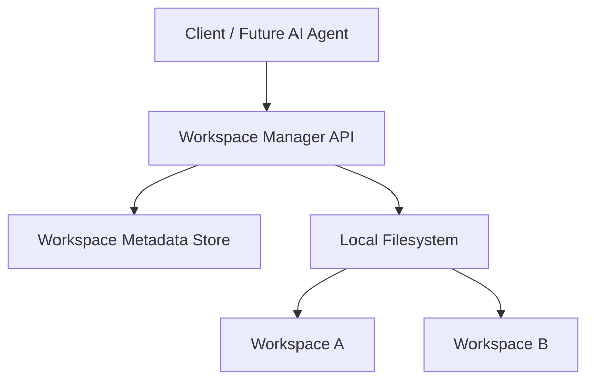

# Scion-Inspired Agent Workspace Manager

## Objective

Build Phase 1 of an agent-native development platform inspired by Anthropic's Scion source-control architecture.

The system should create and manage isolated local filesystem workspaces where multiple AI coding agents can independently read, create, modify, and delete source files.

In this phase, implement workspace management only. Do not build AI agents or a complete version-control system yet.

## 1. Core Architecture

The system consists of:

1. Workspace Manager API
2. Workspace Metadata Store
3. Local Filesystem Storage
4. Workspace Lifecycle Manager

Conceptual architecture:



Each workspace must be isolated from other workspaces.

Multiple workspaces can originate from the same source directory without sharing mutable files.

## 2. Technology Stack

Use:

- Python 3.12+
- FastAPI
- Pydantic
- SQLite for metadata
- Local filesystem for workspace storage
- Pytest for testing

Keep the architecture modular so local storage can later be replaced with S3 or another object store.

## 3. Project Structure

```text
agent-workspace-manager/
├── app/
│   ├── main.py
│   ├── api/
│   │   └── workspaces.py
│   ├── core/
│   │   ├── config.py
│   │   └── exceptions.py
│   ├── models/
│   │   └── workspace.py
│   ├── services/
│   │   └── workspace_manager.py
│   ├── storage/
│   │   ├── filesystem.py
│   │   └── metadata.py
│   └── schemas/
│       └── workspace.py
├── tests/
│   ├── test_workspace_api.py
│   ├── test_workspace_manager.py
│   └── test_workspace_isolation.py
├── data/
│   └── workspaces/
├── pyproject.toml
├── README.md
└── .gitignore
```

## 4. Workspace Lifecycle

Support the following lifecycle:

```text
CREATE
  |
  v
READY
  |
  v
ACTIVE
  |
  v
STOPPED
  |
  v
DELETED
```

Definitions:

- CREATE: Workspace directory and metadata are being initialized.
- READY: Workspace is available for use.
- ACTIVE: Workspace has been explicitly activated.
- STOPPED: Workspace is inactive but its files are preserved.
- DELETED: Workspace files and metadata have been removed or marked deleted.

Define valid state transitions and reject invalid transitions.

Creating a workspace must not automatically start an AI agent.

## 5. Workspace Metadata

Each workspace must store:

```json
{
  "workspace_id": "uuid",
  "name": "payment-agent",
  "source_id": "project-001",
  "base_revision": null,
  "path": "/data/workspaces/uuid",
  "status": "READY",
  "created_at": "ISO-8601",
  "updated_at": "ISO-8601"
}
```

Use SQLite to persist workspace metadata.

The `base_revision` field is reserved for future source-control integration.

Do not implement revisions or commits in Phase 1.

## 6. Workspace Creation API

### POST /workspaces

Request:

```json
{
  "name": "payment-agent",
  "source_path": "/projects/sample-app"
}
```

Behavior:

1. Validate the request.
2. Validate that the source exists and is an allowed directory.
3. Generate a unique workspace ID.
4. Create an isolated workspace directory.
5. Copy source files into the workspace.
6. Persist workspace metadata.
7. Return workspace information.

Response:

```json
{
  "workspace_id": "generated-uuid",
  "name": "payment-agent",
  "status": "READY",
  "path": "/data/workspaces/generated-uuid"
}
```

For Phase 1, use normal filesystem copying.

Do not implement sparse checkout, virtual filesystems, or content-addressed storage yet.

## 7. Required APIs

### POST /workspaces
Create a workspace.

### GET /workspaces
List all workspaces.

### GET /workspaces/{workspace_id}
Get workspace metadata.

### POST /workspaces/{workspace_id}/start
Move a READY or STOPPED workspace to ACTIVE.

### POST /workspaces/{workspace_id}/stop
Move an ACTIVE workspace to STOPPED.

### DELETE /workspaces/{workspace_id}
Delete the selected workspace and its files safely.

Deletion must only affect the requested workspace.

### GET /health
Return application health status.

## 8. Workspace Isolation

This is a critical requirement.

Example:

Source project:

```text
sample-app/
├── main.py
└── utils.py
```

Create two workspaces:

```text
workspaces/
├── workspace-A/
│   ├── main.py
│   └── utils.py
└── workspace-B/
    ├── main.py
    └── utils.py
```

Test:

1. Create Workspace A and Workspace B from the same source.
2. Modify `main.py` in Workspace A.
3. Verify Workspace B remains unchanged.
4. Verify the original source remains unchanged.
5. Delete Workspace A.
6. Verify Workspace B and the original source still exist.

This isolation must be verified with automated tests.

## 9. Filesystem Security

Implement safeguards:

- Configure an explicit allowed source directory.
- Configure an explicit workspace storage root.
- Reject source paths outside the allowed directory.
- Reject source paths inside workspace storage.
- Prevent path traversal.
- Do not follow unsafe symlinks during copying.
- Validate workspace IDs as UUIDs.
- Never accept arbitrary deletion paths from API requests.
- Delete only directories belonging to registered workspaces.
- Protect against workspace creation or deletion races.
- Handle partially failed workspace creation with cleanup.
- Exclude sensitive files such as `.env` and private keys from copies by default.

Do not execute source code during workspace creation.

## 10. Testing Requirements

Write automated tests for:

- Creating a workspace
- Creating multiple workspaces
- Listing workspaces
- Retrieving workspace metadata
- Starting and stopping a workspace
- Invalid lifecycle transitions
- Workspace isolation
- Missing source directories
- Duplicate workspace names
- Invalid workspace IDs
- Path traversal attempts
- Unsafe symlinks
- Deleting one workspace without affecting others
- Metadata persistence after application restart
- Cleanup after failed creation

Use temporary directories for tests.

## 11. Verification Scenario

Create a sample Python project.

Create two workspaces from that project.

Modify a Python file in Workspace A.

Verify:

- Workspace A contains the change.
- Workspace B retains the original file.
- The source project is unchanged.
- Both workspaces have independent metadata.

Stop Workspace A.

Restart it.

Verify that its modified files are preserved.

Delete Workspace A.

Verify Workspace B is unaffected.

## 12. Future Architecture

Design the interfaces to support these future phases:

### Phase 2 — Efficient Workspace Creation
- Shared immutable file objects
- Content-addressed blob storage
- Copy-on-write workspace behavior
- Deduplicated storage

### Phase 3 — Version Control
- Changesets
- File diffs
- Revision history
- Commit creation
- Conflict detection
- Merge operations

### Phase 4 — Agent Execution
- Isolated AI coding agents
- Agent task assignment
- Workspace-to-agent mapping
- Execution logs
- Concurrent agent orchestration

### Phase 5 — Cloud Integration
- S3 object storage
- Centralized metadata database
- Remote workspaces
- Distributed caching
- Authentication and authorization

These are future requirements, not Phase 1 deliverables.

## 13. Acceptance Criteria

Phase 1 is complete when:

- FastAPI application runs locally.
- Workspace creation API works.
- Workspace directories are created correctly.
- Workspace metadata persists in SQLite.
- Multiple isolated workspaces can coexist.
- Workspace lifecycle APIs work.
- Workspace deletion is safely scoped.
- Automated tests pass.
- README contains installation instructions and API examples.

## 14. Implementation Instructions

Implement Phase 1 end-to-end.

Follow these rules:

1. Inspect the existing repository before creating files.
2. Preserve existing functionality.
3. Use modular, maintainable Python code.
4. Use explicit error handling.
5. Keep filesystem operations separate from API handlers.
6. Write tests alongside the implementation.
7. Run all tests and fix failures.
8. Document the API using FastAPI's OpenAPI support.
9. Do not introduce Redis, Docker, Kubernetes, AWS, Git integrations, or agent frameworks unless absolutely necessary.
10. Do not implement future phases prematurely.

Once implementation is complete, provide:

- Project structure
- API endpoints
- Example requests and responses
- Instructions to run the application
- Test results
- Known limitations
- Recommended next step

The immediate goal is a reliable local workspace manager that can later evolve into a Scion-inspired agent-native source-control platform.
